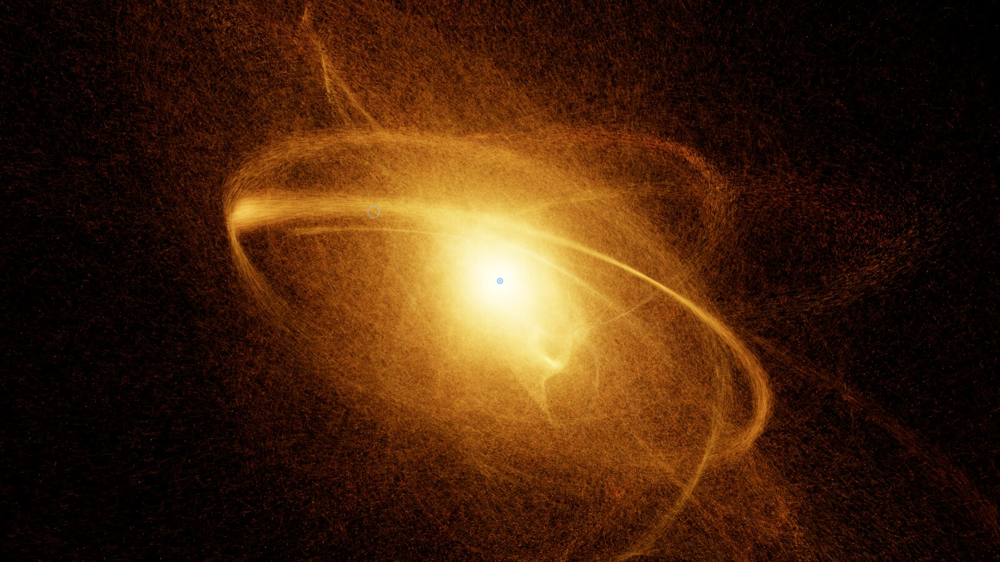
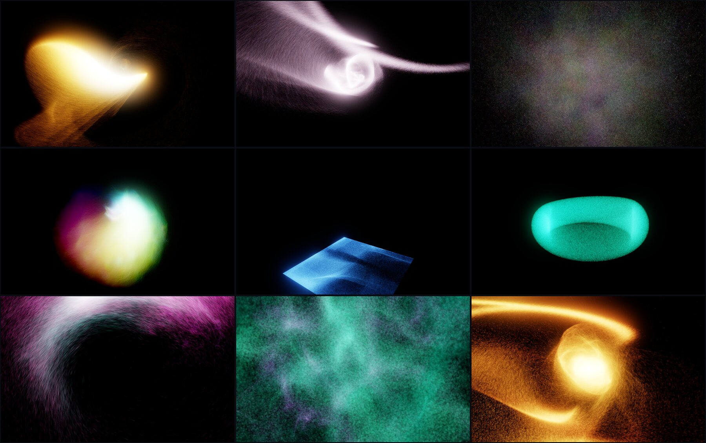
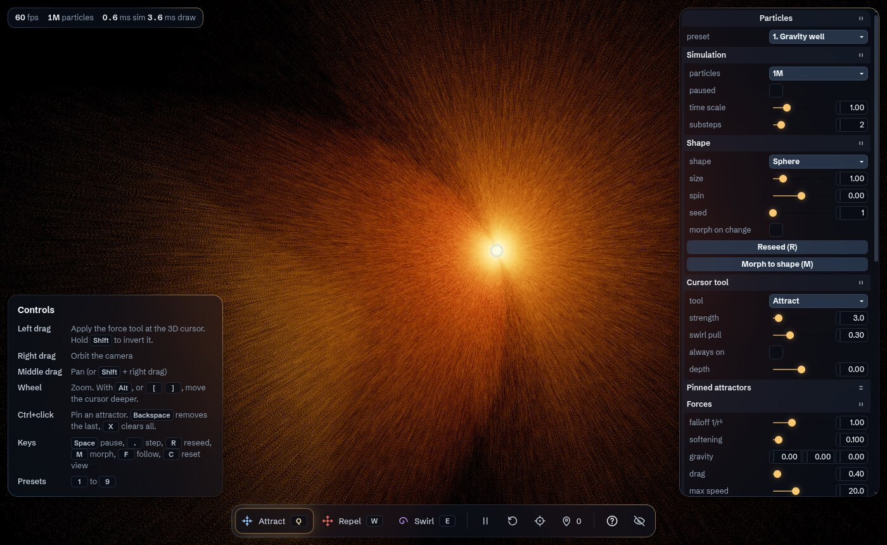

# Particles

Millions of glowing particles that you steer through 3D space with the mouse. Pull them into a
gravity well, push them away, spin them into a whirlpool, or pin attractors in space and watch
a galaxy wind itself up.

The simulation and the drawing both run on the GPU with WebGPU compute shaders. The particles
never leave GPU memory: each frame the browser sends a few hundred bytes of settings, and the
GPU does the rest.



## What you can do

- **Steer** with a 3D cursor and three tools: attract, repel and swirl. Hold Shift to invert any of them.
- **Pin** up to 16 attractors in space. They can orbit, and each pin keeps the tool it was placed with.
- **Shape** the swarm with gravity, drag, divergence-free turbulence, and a spring that pulls every
  particle back to its starting shape. Change the shape and the particles morph across.
- **Choose a look**: 1-pixel points, soft sprites or motion streaks, added together in HDR with
  trails, bloom and a filmic tonemap. Colour particles by speed, direction, depth, distance to the
  cursor, or a palette.
- **Scale** from 64 thousand to 16 million particles. Brightness is normalized, so more particles
  add detail, not glare.
- **Share** a setup: every setting lives in the page URL. Copy the link, or save and load JSON.



<sub>Presets, left to right: gravity well, galaxy, curl flow, light painting, sandbox, elastic torus,
whirlpool, nebula, black hole.</sub>

## Run it

You need [Node.js](https://nodejs.org/) 20.19+ or 22.12+ and a browser with WebGPU.

```sh
git clone git@github.com:theted/particles.git
cd particles
npm install
npm run dev
```

Then open http://localhost:5173.

| Command | What it does |
|---|---|
| `npm run dev` | Development server with hot reload |
| `npm run build` | Typecheck, then build a static site into `dist/` |
| `npm run preview` | Serve the built `dist/` locally |
| `npm run typecheck` | Typecheck only |

The build is plain static files, so any static host can serve it.

### Browser support

WebGPU ships in Chrome and Edge 113+ on Windows, macOS and ChromeOS, in Safari 26, and in Firefox 141+
on Windows. If the page says it found no GPU adapter, open `chrome://gpu` and look for
"WebGPU: Hardware accelerated".

**On Linux** Chromium may still need flags. Start a separate window with its own profile (a running
Chromium ignores new flags):

```sh
chromium --user-data-dir="$HOME/.cache/chromium-webgpu" \
  --enable-unsafe-webgpu --enable-features=Vulkan --ignore-gpu-blocklist \
  http://localhost:5173/
```

On Wayland, Chromium logs "'--ozone-platform=wayland' is not compatible with Vulkan". That message is
about its compositor, and WebGPU works regardless.

## Controls

| Input | Action |
|---|---|
| Left drag | Apply the force tool at the 3D cursor. Hold Shift to invert it. |
| Right drag | Orbit the camera |
| Middle drag, or Shift + right drag | Pan |
| Wheel | Zoom |
| Alt + wheel, or `[` `]` | Move the 3D cursor deeper or closer |
| Ctrl + click | Pin an attractor where the cursor is |
| `Q` `W` `E` | Attract, repel, swirl |
| `Space` | Pause or resume |
| `.` | Step one frame (pauses first) |
| `R` / `M` | Reseed / morph to the selected shape |
| `F` / `C` | Follow the swarm / reset the view |
| `Backspace` / `X` | Remove the last pin / clear all pins |
| `1` to `9` | Presets |
| `H` / `?` | Hide the whole interface / the controls card |

**Where is the 3D cursor?** It sits on a plane that faces the camera and passes through the point
the camera orbits around. The ring under the mouse marks it. Push it deeper or pull it closer with
Alt + wheel, or set it exactly with "depth" in the panel.

The tool dock at the bottom has the same actions as the keys, plus a pin counter: Ctrl+click adds a
pin, and clicking the counter clears them.



## The settings panel

| Section | What it controls |
|---|---|
| Simulation | Particle count, pause, time scale, substeps per frame |
| Shape | Seed shape, size, initial spin and random seed. "Morph on change" keeps the particles where they are and moves only their homes. |
| Cursor tool | Tool, strength, how much a swirl also pulls inward, always on (no click needed), cursor depth |
| Pinned attractors | Pin strength, swirl pull, orbit speed around the vertical axis |
| Forces | Falloff exponent (1/rᵏ), softening, gravity, drag, max speed, turbulence (strength, scale, speed), home spring |
| Bounds | None, wrap, bounce in a box, bounce in a sphere |
| Render | Points, sprites or streaks, sprite size, streak length and width, intensity per million particles, exposure, trail length, colour mode and range, palette, resolution scale, cursor rings |
| Bloom | Threshold, intensity, radius |
| Camera | Field of view, auto-rotate, damping, follow the swarm |
| Performance | Frame rate graph, frame time, GPU time for the simulation and the drawing |
| Save & share | Copy link, save JSON, load JSON |

Presets reset everything except the particle count and resolution, which depend on your machine.

## How it works

```
every frame
  ┌─ compute: step.wgsl ──────────────────────────────────────────────┐
  │ for each particle, all substeps in registers:                     │
  │ forces → velocity → position → bounds                             │
  └───────────────────────────────────────────────────────────────────┘
  ┌─ render: particles.wgsl ──────────────────────────────────────────┐
  │ read the same buffers, add light into an HDR texture that still   │
  │ holds the faded previous frame (that's the trails)                │
  └───────────────────────────────────────────────────────────────────┘
  ┌─ render: post.wgsl ───────────────────────────────────────────────┐
  │ bloom: downsample chain, then upsample and add                    │
  │ tonemap to the screen, and write a faded copy for the next frame  │
  └───────────────────────────────────────────────────────────────────┘
  ┌─ render: gizmo.wgsl ── cursor and pin rings ──────────────────────┐
```

| File | Role |
|---|---|
| `src/main.ts` | Start-up, frame loop, actions shared by keys, dock and panel |
| `src/params.ts` | Every setting in one object: defaults, presets, URL hash encoding |
| `src/sim/particles.ts` | GPU buffers, compute pipelines, uniform packing, centroid readback |
| `src/sim/step.wgsl` | Forces and integration |
| `src/sim/seed.wgsl` | Seed shapes and morph targets |
| `src/sim/noise.wgsl` | Simplex noise gradient and the divergence-free flow field |
| `src/sim/centroid.wgsl` | Mean position of a sample of particles, for follow mode |
| `src/render/draw.ts` | Render pipelines, HDR and bloom textures, the pass sequence |
| `src/render/particles.wgsl` | Points, sprites and streaks, plus colouring |
| `src/render/post.wgsl` | Bloom, tonemap, trail fade |
| `src/render/gizmo.wgsl` | Screen-space rings for the cursor and pins |
| `src/camera.ts` | Orbit camera and the mouse ray for the 3D cursor |
| `src/input.ts` | Mouse and keyboard mapping |
| `src/ui.ts` | The settings panel ([Tweakpane](https://tweakpane.github.io/docs/)) |
| `src/chrome.ts` | Readout, tool dock, controls card, toasts |
| `src/gpu/` | Device set-up, shader error reporting, GPU timestamps |

**Adding a setting:** add it to `makeDefaults()` in `params.ts`, bind it in `ui.ts`, and pack it
into a uniform in `sim/particles.ts` or `render/draw.ts`. Presets and the URL hash pick it up
automatically.

### The math

[docs/math.md](docs/math.md) walks through the equations and why they behave the way they do:
- the integrator and its stability limit
- why a 1/r attractor gives flat rotation curves (and stable galaxies)
- divergence-free "bitangent" noise
- the damped spring behind morphing
- uniform sampling of shapes
- trail half-lives and the fp16 fade
- bloom and the ACES tonemap
- why the simulation is limited by memory bandwidth

## Performance

GPU time per frame on an Intel Arc 140V (integrated graphics) at 1400×860, measured with timestamp
queries:

| Particles | Points: sim + draw | Sprites: sim + draw |
|---|---|---|
| 1M | 0.8 + 0.7 ms | 0.8 + 2.0 ms |
| 4M | 3.2 + 1.9 ms | 3.3 + 7.1 ms |
| 16M | 13 + 7 ms | 19 + 48 ms |

At 4M particles the simulation moves about 100 GB/s, close to that machine's memory bandwidth. The
math is cheap; reading and writing 64 to 80 bytes per particle per frame is not.

## Development

- Shader compile errors and GPU validation errors appear on the page, not only in the console.
- In development builds, `window.particles` exposes the params, camera, input and actions. It also has
  `step(frames, dt)`, which advances frames without `requestAnimationFrame`. That matters for
  automation tabs, which are often hidden, so rAF never fires there.
- Headless Chromium can drive the real GPU for screenshots:
  `chromium --headless=new --use-angle=vulkan --enable-features=Vulkan --ignore-gpu-blocklist`.
  Load the app from `http://localhost`: WebGPU is only available in secure contexts, so it is missing
  on `about:blank`.

## Credits

- Simplex noise gradient adapted from [webgl-noise](https://github.com/stegu/webgl-noise) by Ian McEwan
  and Stefan Gustavson (MIT).
- Bloom filters after Jorge Jimenez, "Next Generation Post Processing in Call of Duty: Advanced Warfare"
  (SIGGRAPH 2014). ACES fit by Krzysztof Narkowicz. PCG hash after Jarzynski and Olano, "Hash Functions
  for GPU Rendering" (JCGT 2020).
- [Tweakpane](https://tweakpane.github.io/docs/) for the panel, [wgpu-matrix](https://github.com/greggman/wgpu-matrix)
  for the math, [Vite](https://vite.dev/) for the build.
- The interface uses the tokens of [glass-design-system](https://github.com/theted/glass-design-system):
  cobalt glass, with warm light only on what is active.
